# Báo cáo HW05 – Performance Testing – Task 1

| Mục | Nội dung |
|---|---|
| MSSV | 23120184 |
| Họ tên | Nguyễn Anh Tuấn |
| Bài tập | HW05-AI – Performance Testing (cá nhân) – Task 1: AI-assisted test design and execution |
| SUT | EShop (https://github.com/ttbhanh/eshop-sut), backend REST tại http://localhost:3000 |
| Công cụ | Apache JMeter 5.6.3 (chạy non-GUI, xuất HTML dashboard), Windows Task Manager |
| Thời gian thực hiện | 20/11/2026 – 21/11/2026 (giờ GMT+7) |
| Repo GitHub (công khai) | https://github.com/nguyenanhtuan2702/HW05 |
| **Video demo (YouTube unlisted)** | [Xem video demo](https://www.youtube.com/watch?v=J2pilpxvBZo) (chi tiết ở mục 9) |

---

## 1. Tóm tắt kết quả

| Kịch bản | Cấu hình | Samples | Workflow hoàn tất | Workflow/s | Lỗi | P95 toàn kịch bản (ms) | Request throughput | Kết luận |
|---|---|---:|---:|---:|---:|---:|---|---|
| Load | 5 VU, ramp-up 10 s, 10 vòng/VU | 200 | 50 | 1.2853 | 0 | 16.95 | 5.14 req/s | APDEX 1.000 cho cả 4 request; không có lỗi trong lượt chạy. |
| Stress | 20 VU, ramp-up 30 s, 20 vòng/VU | 1,600 | 400 | 4.4785 | 0 | 17.00 | 17.91 req/s (đỉnh quan sát theo cửa sổ: 26.8 req/s) | Trong phạm vi tải đã thử, không lỗi hoặc suy giảm rõ; chưa xác định capacity hay điểm gãy. |
| Spike | 2 VU nền, đột biến lên 20 VU trong 1 s | 304 | 76 | 1.1551 | 0 | 32.75 | 4.62 req/s | Có 5 mẫu chậm 1.28–1.65 s sau cửa sổ high-concurrency; nguyên nhân chưa xác định. |
| Soak | 5 VU, 610 s | 3,890 | 970 | 1.5911 | 0 | 59.00 | 6.38 req/s | Không có lỗi; response time dao động rồi hồi phục. Working set tăng giữa 3 lần chụp, chưa đủ dữ liệu kết luận memory leak. |

Kết luận chung:

- 5,994 request qua 4 lần chạy, **0 lỗi** (gồm 1,501 lần đăng nhập; không lần nào bị từ chối hay khóa tài khoản).
- Soak ghi nhận **6.38 request/s trong 609.651 s**, P95 toàn kịch bản 59 ms và **970 workflow hoàn tất, tương đương 1.5911 workflow/s**. Request throughput không đồng nghĩa workflow throughput vì một workflow gồm bốn request; Soak còn 5 workflow chưa hoàn tất khi dừng.
- Workflow hoàn tất được đếm khi cùng `threadName` có đủ thứ tự label `01 → 02 → 03 → 04`; workflow/s bằng số workflow hoàn tất chia cho cùng khoảng đo JTL. Các kịch bản Load, Stress và Spike có lần lượt 50, 400 và 76 workflow hoàn tất.
- Stress ghi nhận đỉnh ngắn hạn **26.8 request/s** theo cửa sổ 10 giây ở 20 VU. Đây là tải lớn nhất quan sát được trong các lượt chạy, không phải phép đo giới hạn capacity. Think-time giới hạn tốc độ phát sinh request của workload đóng vòng; chưa có bằng chứng xác định trần thật của server (mục 8).
- Phát hiện đáng chú ý nhất: `GET /api/admin/orders` trả toàn bộ bảng đơn hàng, không phân trang (mục 7.5 và mục 10).

---

## 2. Môi trường thực nghiệm

Môi trường thực nghiệm được thiết lập trên máy tính cá nhân sử dụng hệ điều hành Windows 11. Apache JMeter và Backend EShop được chạy trên cùng một máy tính, giao tiếp thông qua địa chỉ localhost. Thông tin cấu hình phần cứng và phần mềm được thu thập bằng PowerShell, JMeter log và Windows Task Manager.

### 2.1. Cấu hình phần cứng và phần mềm

| Thành phần | Giá trị | Nguồn |
|---|---|---|
| Hệ điều hành | Microsoft Windows 11 Home Single Language (10.0.26300), 64-bit | PowerShell (`Win32_OperatingSystem`) |
| Hostname | `nguyenatuan143` | PowerShell (`hostname`) |
| CPU | 13th Gen Intel(R) Core(TM) i7-1355U; 10 cores; 12 logical processors | PowerShell (`Win32_Processor`) |
| RAM | 15.69 GB (xấp xỉ 16 GB) | PowerShell (`Win32_ComputerSystem`) |
| Ổ đĩa | NVMe EG6 KIOXIA 512GB; SSD; NVMe; dung lượng hệ thống nhận diện 476.94 GB | PowerShell (`Get-PhysicalDisk`) |
| JMeter | Apache JMeter 5.6.3 | `jmeter.log` |
| Java | Java 25.0.2 (HotSpot 64-Bit Server VM), heap tối đa 1 GB | `jmeter.log` |
| Backend EShop | Node.js (`node.exe`), cổng 3000 | Windows Task Manager |
| Máy thực thi | JMeter và Backend chạy trên cùng một máy tính, kết nối thông qua `localhost` | Cấu hình thực nghiệm |

### 2.2. Mô tả môi trường thực nghiệm

Máy tính sử dụng bộ vi xử lý Intel Core i7-1355U thế hệ thứ 13, gồm 10 nhân xử lý vật lý và 12 bộ xử lý logic, cùng với 15.69 GB RAM được hệ điều hành nhận diện. Hệ thống sử dụng ổ cứng SSD NVMe KIOXIA EG6 với dung lượng danh nghĩa 512 GB.

Apache JMeter phiên bản 5.6.3 được sử dụng để tạo tải và thu thập các chỉ số hiệu năng. Môi trường thực thi sử dụng Java 25.0.2 với HotSpot 64-Bit Server VM và giới hạn Java heap tối đa 1 GB.

Backend của ứng dụng EShop được triển khai bằng Node.js và chạy trên cổng 3000. Cả JMeter và Backend đều được thực thi trên cùng một máy tính, các request được gửi đến địa chỉ `localhost:3000`.

Việc triển khai trên cùng một máy giúp đơn giản hóa môi trường thực nghiệm, tuy nhiên tài nguyên CPU và RAM được chia sẻ giữa tiến trình JMeter và Backend. Vì vậy, kết quả kiểm thử có thể chịu ảnh hưởng từ mức độ sử dụng tài nguyên của cả hai tiến trình, cần được xem xét khi phân tích các chỉ số hiệu năng.

### 2.3. Minh chứng cấu hình phần cứng

Các thông tin về CPU, RAM và ổ đĩa được thu thập trực tiếp bằng PowerShell thông qua các lệnh truy vấn hệ thống Windows. Hình ảnh minh chứng cấu hình phần cứng được lưu trong thư mục `evidence/` và đính kèm cùng báo cáo.

- CPU và số lượng logical processors: PowerShell – `Win32_Processor`.
- Dung lượng RAM: PowerShell – `Win32_ComputerSystem`.
- Thông tin ổ đĩa: PowerShell – `Get-PhysicalDisk`.
- Thông tin hệ điều hành và hostname: PowerShell – `Win32_OperatingSystem` và `hostname`.

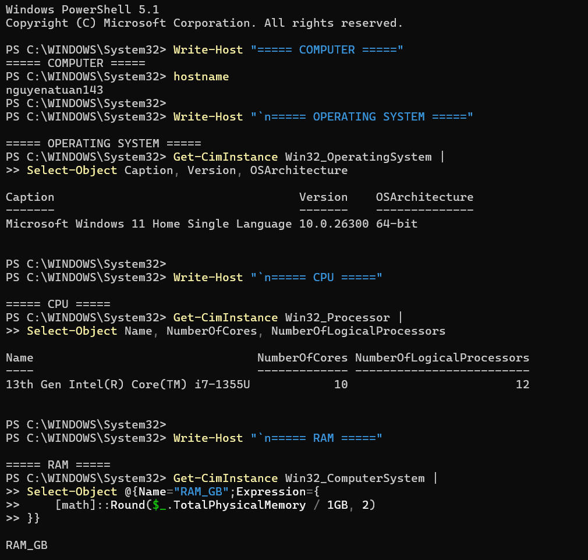

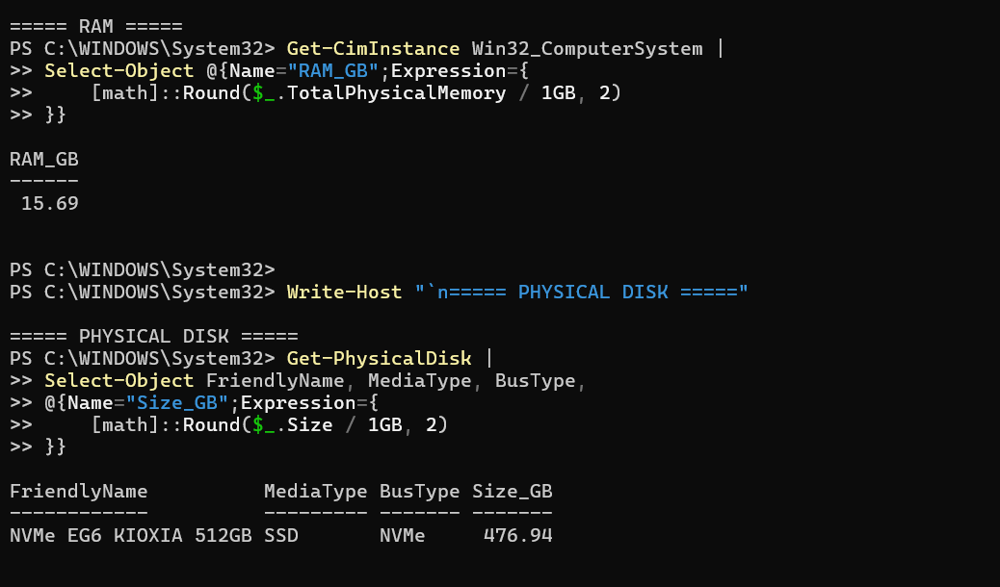


---

## 3. Luồng end-to-end và phủ ba nhóm endpoint

Cả Load, Stress, Spike và Soak dùng **cùng một luồng**: quản trị viên đăng nhập, đọc danh sách đơn, xác nhận một đơn đang `pending`, rồi đọc lại để kiểm tra đúng đơn đó đã chuyển sang `confirmed`. Luồng được khảo sát thủ công bằng Chrome DevTools ngày 20/11/2026 trước khi viết plan (chi tiết trong `workflow.md`).

| Bước | Request | Nhóm endpoint | Vai trò |
|---|---|---|---|
| 01 | `POST /api/login` (body `email`, `password`) | Auth-heavy | Đăng nhập admin, trích `token` bằng JSON Extractor vào biến `adminToken`. |
| 02 | `GET /api/admin/orders` | Read-heavy | Đọc danh sách đơn, kiểm tra đơn `orderId` đang ở trạng thái `pending`. |
| 03 | `PUT /api/admin/orders/${orderId}/status` (body `{"status":"confirmed"}`) | Transactional | Chuyển trạng thái đơn, ghi vào cơ sở dữ liệu. |
| 04 | `GET /api/admin/orders` | Read-heavy | Đọc lại, kiểm tra đúng đơn `orderId` đã `confirmed`. |

Lý do mỗi bước thuộc nhóm tương ứng:

- **Auth-heavy:** đăng nhập nằm **trong vòng lặp**, nên mỗi vòng thực hiện một lần xác thực đầy đủ. Đăng nhập chiếm 25% số request. Plan xử lý khóa 3 lần sai bằng cách dùng tài khoản hợp lệ và đặt `on_sample_error = stopthread` (VU dừng ngay khi có lỗi, không tiếp tục gửi đăng nhập). Kết quả: 1501 lần đăng nhập, 0 thất bại, không kích hoạt khóa.
- **Read-heavy:** hai trong bốn request là đọc danh sách đơn. Endpoint này trả toàn bộ bảng đơn; JMeter ghi nhận response body từ khoảng 8.7 KB (Load) đến 352 KB (Soak) mỗi lần đọc. Đây là cột `bytes`, không phải phép đo tổng byte trên wire.
- **Transactional:** bước 03 thay đổi trạng thái đơn, là thao tác ghi duy nhất. Mỗi đơn chỉ chuyển `pending` sang `confirmed` được một lần, nên dữ liệu đầu vào phải được chuẩn bị riêng cho từng lần chạy (mục 4).

Bằng chứng khảo sát luồng (DevTools):

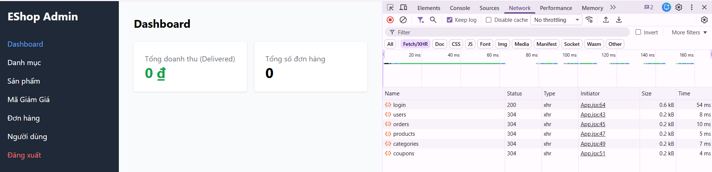

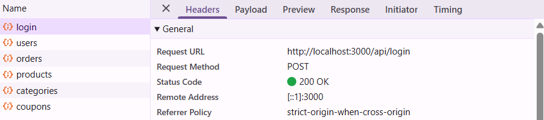

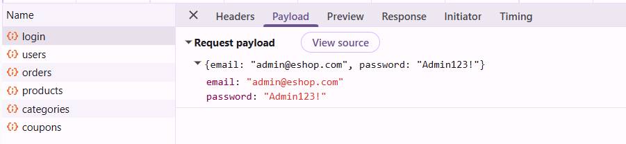

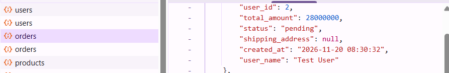

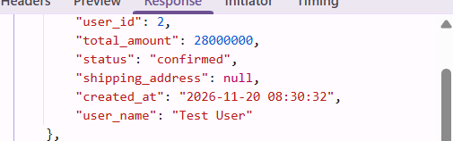

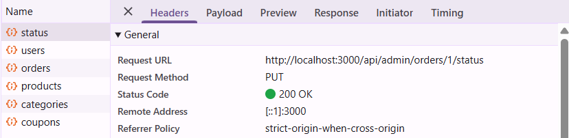

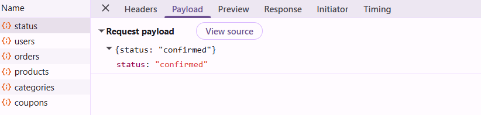

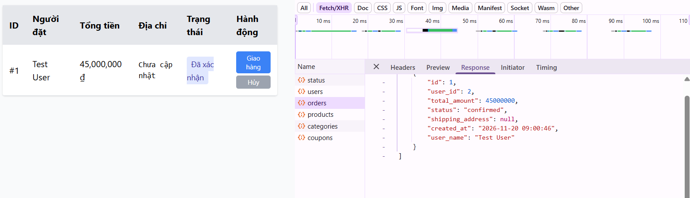

---

## 4. Chuẩn bị đơn hàng và tạo dữ liệu CSV

### 4.1. Dữ liệu đầu vào cho từng kịch bản

Mỗi vòng kiểm thử xử lý một đơn hàng. Đầu vòng, JMeter cần tìm được đơn đang ở trạng thái `pending`. Cuối vòng, JMeter đọc lại đúng mã đơn để xác nhận trạng thái đã chuyển thành `confirmed`. Vì vậy, dữ liệu được chuẩn bị bằng cách tạo đơn thật qua API của EShop trước khi bắt đầu đo. Thời gian tạo đơn và đăng nhập của khách hàng nằm ngoài số liệu hiệu năng của luồng quản trị.

| Kịch bản | File trong thư mục `data/` | Số dòng dữ liệu | ID trong file đã dùng | Cơ sở chọn số dòng |
|---|---|---:|---|---|
| Load | `orders.csv` | 50 | 5–54 | 5 người dùng × 10 vòng |
| Stress | `orders_stress.csv` | 400 | 1–400 | 20 người dùng × 20 vòng |
| Spike | `orders_spike.csv` | 76 | 401–476 | 2 người dùng nền × 20 vòng và 18 người dùng bổ sung × 2 vòng |
| Soak | `orders_soak.csv` | 1.600 | 477–2076 | Chuẩn bị dư để duy trì tải trong 610 giây. Log ghi nhận 975 lần đăng nhập và 970 vòng hoàn tất. |

Số dòng trên đã loại dòng tiêu đề. ID là duy nhất trong từng file. Dải ID của Load giao với dải ID của Stress, nên ID được hiểu theo dữ liệu của lần chạy tương ứng. Khi tái lập, giá trị đáng dùng là `orderId` do backend trả về ở lần chuẩn bị mới.

### 4.2. Tạo CSV bằng PowerShell

Script dưới đây tổng hợp quy trình đã dùng cho bốn kịch bản. Trên máy Windows chạy EShop, khởi động backend ở cổng 3000, lưu khối mã thành `Prepare-Orders.ps1` tại `D:\HW05\task1`, rồi gọi script cho **một kịch bản ngay trước lần đo tương ứng**. Đầu vào gồm tên kịch bản và nhãn lô. Tài khoản khách hàng dùng để tạo đơn, còn tài khoản quản trị trong JMeter dùng để xác nhận đơn.

1. Gửi `POST /api/login` để lấy token của khách hàng.
2. Với mỗi dòng cần chuẩn bị, đặt nhãn riêng trong `shipping_address`. Đọc `GET /api/orders/my-orders` để nhận diện đơn đã tạo nếu lần chuẩn bị trước bị ngắt.
3. Nếu nhãn chưa tồn tại, gửi `POST /api/checkout` với `total_amount = 100000` và nhãn tương ứng. Backend tạo đơn ở trạng thái `pending` rồi trả `orderId`.
4. Kiểm tra số ID phân biệt, sau đó ghi file CSV. Nếu lô cũ đã có đơn được xác nhận, chọn nhãn lô mới cho lần đo mới.

```powershell
param(
    [Parameter(Mandatory)]
    [ValidateSet('Load', 'Stress', 'Spike', 'Soak')]
    [string]$Scenario,

    [Parameter(Mandatory)]
    [string]$Batch
)

$ErrorActionPreference = 'Stop'
$api = 'http://localhost:3000/api'
$dataDir = Join-Path $PSScriptRoot 'data'
$plans = @{
    Load   = @{ File = 'orders.csv';        Count = 50 }
    Stress = @{ File = 'orders_stress.csv'; Count = 400 }
    Spike  = @{ File = 'orders_spike.csv';  Count = 76 }
    Soak   = @{ File = 'orders_soak.csv';   Count = 1600 }
}
$plan = $plans[$Scenario]
$csvPath = Join-Path $dataDir $plan.File
New-Item -ItemType Directory -Path $dataDir -Force | Out-Null

$account = Get-Credential -UserName 'test@eshop.com' -Message 'EShop customer login'
if (-not $account) { return }
$loginBody = @{
    email    = $account.UserName
    password = $account.GetNetworkCredential().Password
} | ConvertTo-Json
$login = Invoke-RestMethod -Method Post -Uri "$api/login" `
    -ContentType 'application/json' -Body $loginBody
if (-not $login.token) { throw 'Login did not return a token.' }
$headers = @{ Authorization = "Bearer $($login.token)" }

$existing = Invoke-RestMethod -Uri "$api/orders/my-orders" -Headers $headers
$byLabel = @{}
foreach ($order in $existing) {
    $label = [string]$order.shipping_address
    if (-not $label.StartsWith("$Batch-")) { continue }
    if ($byLabel.ContainsKey($label)) { throw "Duplicate batch label: $label" }
    $byLabel[$label] = $order
}

$ids = foreach ($i in 1..($plan.Count)) {
    $label = '{0}-{1:D3}' -f $Batch, $i
    if ($byLabel.ContainsKey($label)) {
        $order = $byLabel[$label]
        if ($order.status -ne 'pending') { throw "Use a new batch: $label is $($order.status)." }
        $id = $order.id
    } else {
        $body = @{ total_amount = 100000; shipping_address = $label } | ConvertTo-Json
        $result = Invoke-RestMethod -Method Post -Uri "$api/checkout" `
            -Headers $headers -ContentType 'application/json' -Body $body
        $id = $result.orderId
    }
    if ([long]$id -lt 1) { throw "Missing orderId for $label" }
    [long]$id
}
if (@($ids | Sort-Object -Unique).Count -ne $plan.Count) {
    throw 'Unexpected number of distinct order IDs.'
}
$rows = @('orderId,initialStatus,targetStatus') + @(
    $ids | ForEach-Object { "$_,pending,confirmed" }
)
Set-Content -LiteralPath $csvPath -Value $rows -Encoding ascii
Write-Host "$csvPath - $(@(Import-Csv -LiteralPath $csvPath).Count) orders"
Get-Content -LiteralPath $csvPath -TotalCount 4
```

Ví dụ gọi script từ PowerShell. Mỗi lệnh ứng với một lần chuẩn bị độc lập. Với lần chuẩn bị bị ngắt, chạy lại cùng lệnh và nhãn lô. Khi đo lại sau khi JMeter đã xác nhận đơn, đổi hậu tố lô và giữ bản CSV cũ cùng kết quả nếu cần đối chiếu.

```powershell
Set-Location D:\HW05\task1
.\Prepare-Orders.ps1 -Scenario Load   -Batch HW05-Load-R01
.\Prepare-Orders.ps1 -Scenario Stress -Batch HW05-Stress-R01
.\Prepare-Orders.ps1 -Scenario Spike  -Batch HW05-Spike-R01
.\Prepare-Orders.ps1 -Scenario Soak   -Batch HW05-Soak-R01
```

### 4.3. Kiểm tra file và liên kết với JMeter

Trong lần chạy Spike, PowerShell đếm được 76 dòng dữ liệu. Ba dòng đầu của file minh họa cách ánh xạ từ ID thật sang trạng thái đầu và cuối của một vòng kiểm thử.

```csv
orderId,initialStatus,targetStatus
401,pending,confirmed
402,pending,confirmed
403,pending,confirmed
```

Trong **CSV Data Set Config**, đặt `Filename` theo đường dẫn tương đối từ file JMX, ví dụ `../data/orders_spike.csv`. Để trống **Variable Names** để JMeter lấy tên biến từ dòng tiêu đề. Dùng dấu phẩy làm dấu phân tách, chọn **All threads**, **Recycle on EOF = False** và **Stop thread on EOF = True**. Riêng Spike đặt CSV ở cấp Test Plan để hai nhóm nền và đột biến cùng lấy dòng từ một file.

| Bước | Giá trị lấy từ CSV | Cách đối chiếu |
|---|---|---|
| 02 – Đọc danh sách | `orderId`, `initialStatus` | Lọc phản hồi theo đúng ID, kiểm tra trạng thái là `pending`. |
| 03 – Xác nhận | `orderId`, `targetStatus` | Gửi PUT tới `/api/admin/orders/${orderId}/status` với body `{"status":"${targetStatus}"}`. |
| 04 – Đọc lại | `orderId`, `targetStatus` | Tìm lại cùng ID và kiểm tra trạng thái là `confirmed`. |

Khi kiểm tra cấu hình bằng 1 thread × 1 vòng, có thể đối chiếu ID trong **03 → Request** với cùng ID ở **02 → Response Data** và **04 → Response Data**. Vòng kiểm tra này cũng xác nhận một đơn thật, nên cần dành một đơn thử riêng trước khi đo chính thức. Trong bốn lần đo, tất cả lượt đăng nhập đều thành công và tài khoản không cần mở khóa.

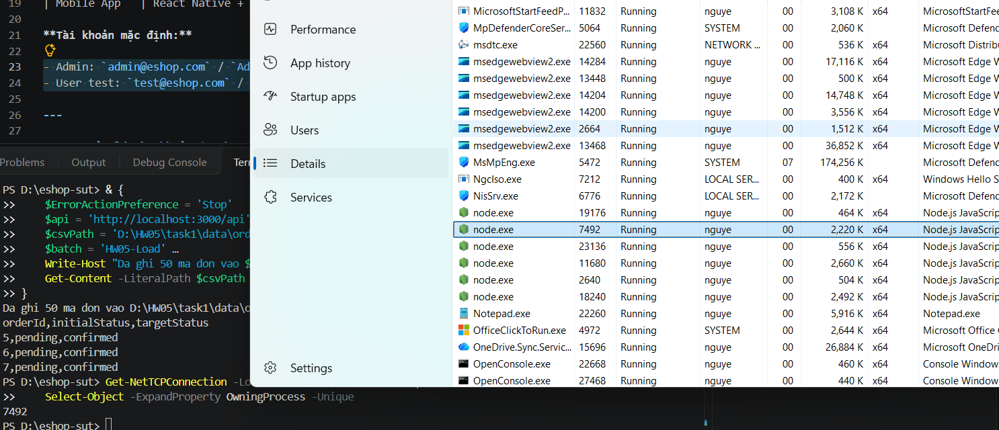

---

## 5. Thiết kế bốn kịch bản

### 5.1 Tham số và lý do chọn

Think-time dùng chung cho cả bốn plan: **Uniform Random Timer, 2000 ms cố định cộng ngẫu nhiên 0–2000 ms (2–4 s, trung bình 3 s)**, gắn vào bước 03. Lý do: quản trị viên xem đơn rồi mới bấm xác nhận, nên khoảng dừng nằm giữa bước đọc và bước ghi.

| Kịch bản | Tên file plan | Thread group | Ramp-up | Thời lượng / số vòng | Lý do chọn |
|---|---|---|---|---|---|
| Load | `23120184_Load_20261120.jmx` | 5 VU | 10 s | 10 vòng/VU (50 vòng) | Mô phỏng vài quản trị viên xử lý đơn cùng lúc, tải thường ngày. Làm mốc so sánh. |
| Stress | `23120184_Stress_20261120.jmx` | 20 VU | 30 s | 20 vòng/VU (400 vòng) | Gấp 4 lần Load, ramp-up dài hơn để tải tăng dần. Mục tiêu: tìm ngưỡng bắt đầu suy giảm. |
| Spike | `23120184_Spike_20261121.jmx` | 2 VU nền + 18 VU đột biến | 1 s cho cả hai nhóm | Nền: 20 vòng/VU. Đột biến: bắt đầu sau 15 s, 2 vòng/VU | Tải nền thấp, sau 15 s thêm 18 VU trong 1 s (tổng 20 VU, gấp 10 lần nền), sau đó trở lại tải nền để quan sát khả năng phục hồi. |
| Soak (endurance) | `23120184_Soak_20261121.jmx` | 5 VU | 10 s | Chạy theo thời gian 610 s (10 phút 10 s), lặp vô hạn | Duy trì tải bằng mức Load trong hơn 10 phút để tìm ngưỡng bền vững và xu hướng bộ nhớ. |

Hình dạng tải thực tế của Spike (biểu đồ Active Threads Over Time): 2 VU, tăng lên 20 VU quanh 09:19:20, rồi quay về 2 VU sau khoảng 8 giây (nhóm đột biến chạy từ giây 14.8 đến 23.2 trong `spike.jtl`).

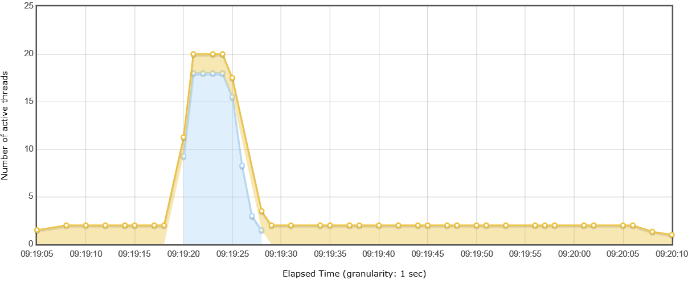

### 5.2 Kiểm tra (assertion)

Cả hai request đọc danh sách dùng JMESPath Assertion lọc **đúng đơn đang kiểm thử** theo `orderId`:

```
[?id == `${orderId}`].status | [0]
```

- Bước 02: giá trị kỳ vọng là `${initialStatus}` (`pending`).
- Bước 04: giá trị kỳ vọng là `${targetStatus}` (`confirmed`).
- Các request còn lại dùng kiểm tra mặc định của JMeter (mã HTTP).

Minh chứng vì sao phải lọc theo `orderId`: trước khi xác nhận, danh sách có đơn #2 đã `confirmed` từ trước còn đơn #1 đang `pending`. Kiểm tra kiểu “phản hồi có chữ confirmed” sẽ báo đạt sai.

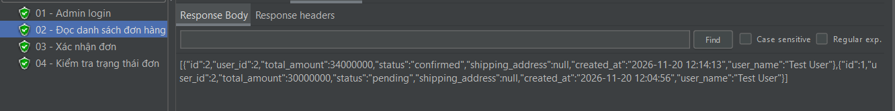

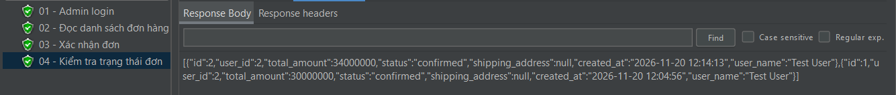

### 5.3 Report view

Ba plan chính dùng ba loại listener khác nhau, không lặp:

| Plan | Listener đang bật khi đo | Ghi chú |
|---|---|---|
| Load | Summary Report | View Results Tree chỉ bật khi chạy thử (ảnh T109), tắt khi đo để không tốn bộ nhớ. |
| Stress | Aggregate Report | |
| Spike | Aggregate Graph | |
| Soak | Summary Report | Plan bổ sung, không thuộc ba plan bắt buộc. |

Ngoài listener, mỗi lần chạy đều xuất file `.jtl` đầy đủ và HTML dashboard.

---

## 6. Thực thi và sản phẩm

Lệnh chạy dạng non-GUI, sinh `.jtl`, log và HTML dashboard trong một thư mục theo thời điểm chạy:

```
jmeter -n -t plans\<tên_plan>.jmx -l results\<kịch_bản>\<thời_điểm>\<kịch_bản>.jtl -j results\<kịch_bản>\<thời_điểm>\jmeter.log -e -o results\<kịch_bản>\<thời_điểm>\html
```

| Lần chạy | Bắt đầu – kết thúc (GMT+7) | Thư mục kết quả | Số sample (data rows, không tính header) |
|---|---|---|---|
| Load | 20/11/2026 19:59:10 – 19:59:49 | `results/load/20261120_195907/` | 200 |
| Stress | 21/11/2026 08:48:20 – 08:49:49 | `results/stress/20261121_084816/` | 1,600 |
| Spike | 21/11/2026 09:19:05 – 09:20:10 | `results/spike/20261121_091902/` | 304 |
| Soak | 21/11/2026 09:43:01 – 09:53:10 | `results/soak/20261121_094256/` | 3,890 |

Mỗi thư mục chứa `<kịch_bản>.jtl` (log thô; số sample ở bảng không tính dòng header), `jmeter.log` và `html/index.html` (dashboard).

Lưu ý: PID của backend khác nhau giữa Load (7492) và các lần chạy sau (11180), tức backend đã được chạy lại giữa hai ngày.

---

## 7. Kết quả chi tiết

Số liệu lấy từ HTML dashboard của JMeter (khớp với `statistics.json` trong từng thư mục). Đơn vị thời gian là mili giây.

### 7.1 Bảng so sánh bốn lần chạy

| | Load | Stress | Spike | Soak |
|---|---|---|---|---|
| VU | 5 | 20 | 2 → 20 → 2 | 5 |
| Samples | 200 | 1,600 | 304 | 3,890 |
| Lỗi | 0 (0.00%) | 0 (0.00%) | 0 (0.00%) | 0 (0.00%) |
| Trung bình | 7.86 | 8.43 | 35.45 | 21.42 |
| Median | 6 | 8 | 11 | 15 |
| P90 | 14.00 | 14.00 | 23.50 | 47.00 |
| P95 | 16.95 | 17.00 | 32.75 | 59.00 |
| P99 | 27.93 | 31.00 | 1324.30 | 93.09 |
| Min / Max | 3 / 62 | 0 / 60 | 2 / 1653 | 0 / 391 |
| Request throughput (req/s) | 5.14 | 17.91 | 4.62 | 6.38 |
| Nhận (KB/s) | 23.05 | 600.23 | 184.71 | 1099.19 |

Các percentile ở bảng này là số liệu tổng hợp toàn kịch bản, bao gồm cả bốn request label; không đại diện cho một endpoint riêng. Ví dụ ở Spike, P95 toàn kịch bản là 32.75 ms, nhưng P95 của bước 03 – Xác nhận đơn là 1,282.65 ms theo JMeter Dashboard. Khi đánh giá từng API cần dùng bảng theo request bên dưới. Percentile tính trực tiếp từ raw JTL bằng linear interpolation có thể khác Dashboard do convention khác nhau; khác biệt này không tự động đồng nghĩa với lỗi số học.

Lưu ý khi so sánh: **các lần chạy không so sánh trực tiếp được** vì kích thước bảng đơn hàng khác nhau giữa các lần chạy (mục 7.5).

### 7.2 Load (5 VU)

| Request | Samples | Lỗi | Avg | Median | P90 | P95 | P99 | Min | Max |
|---|---|---|---|---|---|---|---|---|---|
| 01 – Admin login | 50 | 0 | 6.5 | 5 | 7.9 | 9.9 | 62.0 | 3 | 62 |
| 02 – Đọc danh sách đơn hàng | 50 | 0 | 5.4 | 5 | 8.0 | 9.5 | 10.0 | 3 | 10 |
| 03 – Xác nhận đơn | 50 | 0 | 14.1 | 14 | 19.0 | 20.5 | 28.0 | 8 | 28 |
| 04 – Kiểm tra trạng thái đơn | 50 | 0 | 5.5 | 5 | 7.9 | 9.0 | 11.0 | 3 | 11 |
| **Tổng** | **200** | **0** | **7.9** | **6** | **14.0** | **17.0** | **27.9** | **3** | **62** |

**Kết luận: đạt.** Cả 50 vòng hoàn tất, mọi assertion theo `orderId` đều đúng. APDEX 1.000 (ngưỡng 500 ms) cho cả bốn request. Mẫu chậm nhất (62 ms) là lần đăng nhập đầu tiên, nhiều khả năng do kết nối và khởi động nguội. Bước ghi (03) chậm hơn các bước đọc khoảng 2.5 lần (14.1 ms so với 5.4–5.5 ms), đúng kỳ vọng với thao tác ghi.

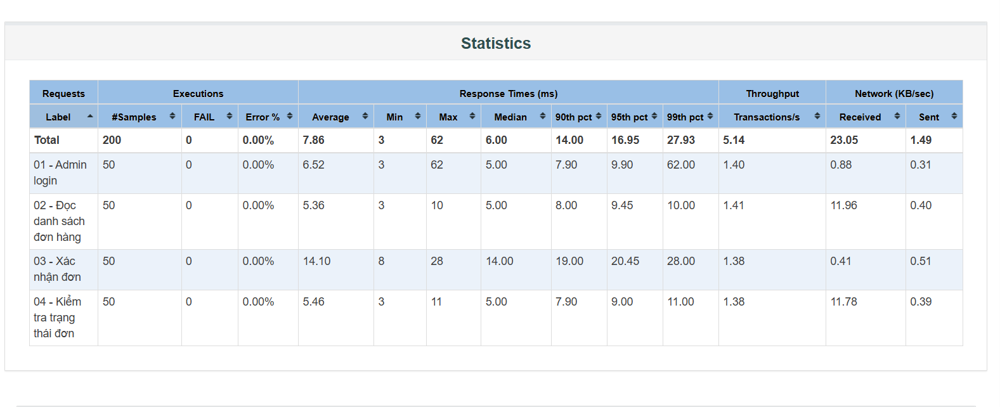

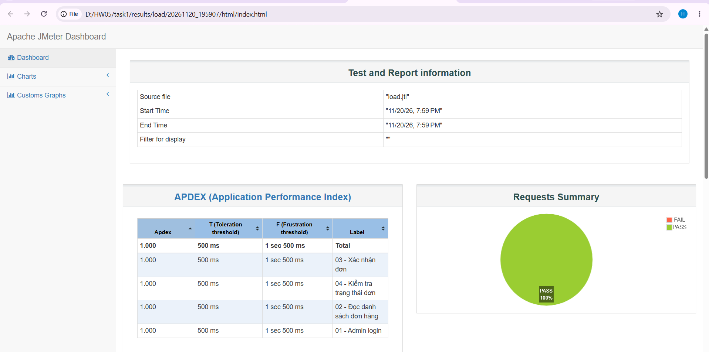

### 7.3 Stress (20 VU)

| Request | Samples | Lỗi | Avg | Median | P90 | P95 | P99 | Min | Max |
|---|---|---|---|---|---|---|---|---|---|
| 01 – Admin login | 400 | 0 | 4.6 | 4 | 8.0 | 11.0 | 15.0 | 0 | 60 |
| 02 – Đọc danh sách đơn hàng | 400 | 0 | 8.7 | 8 | 14.0 | 17.0 | 31.0 | 1 | 38 |
| 03 – Xác nhận đơn | 400 | 0 | 11.2 | 11 | 16.9 | 19.0 | 28.0 | 4 | 46 |
| 04 – Kiểm tra trạng thái đơn | 400 | 0 | 9.2 | 8 | 15.0 | 21.0 | 35.0 | 2 | 43 |
| **Tổng** | **1,600** | **0** | **8.4** | **8** | **14.0** | **17.0** | **31.0** | **0** | **60** |

Diễn biến theo cửa sổ 10 giây (tính lại từ `stress.jtl`):

| Giây | VU hoạt động (tối đa) | Throughput (req/s) | P95 (ms) |
|---|---|---|---|
| 0–10 | 7 | 5.0 | 34.6 |
| 10–20 | 14 | 14.6 | 25.5 |
| 20–30 | 20 | 21.5 | 16.3 |
| 30–40 | 20 | 26.1 | 17.0 |
| 40–50 | 20 | 26.4 | 13.0 |
| 50–60 | 20 | 26.8 | 11.6 |
| 60–70 | 20 | 22.0 | 16.0 |
| 70–80 | 14 | 12.6 | 14.8 |
| 80–90 | 7 | 5.0 | 20.5 |

**Kết luận: trong mức tải 20 VU đã thử, chưa thấy lỗi hoặc suy giảm rõ; lượt chạy này chưa xác định được điểm gãy/capacity.** P95 gần như không đổi so với Load (17.00 so với 16.95 ms) và không có mẫu lỗi. Ở giai đoạn đủ 20 VU, request throughput nằm quanh 26–27 req/s và P95 theo cửa sổ là 11.6–17 ms. Độ trễ lớn nhất xuất hiện trong 10 giây đầu, khi tải đang tăng, không phải lúc ghi nhận throughput cao nhất. Workload có think-time nên số liệu này không chứng minh 20 VU là hay không là áp lực tối đa của server (xem mục 8 và mục 11).

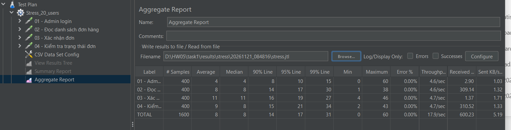

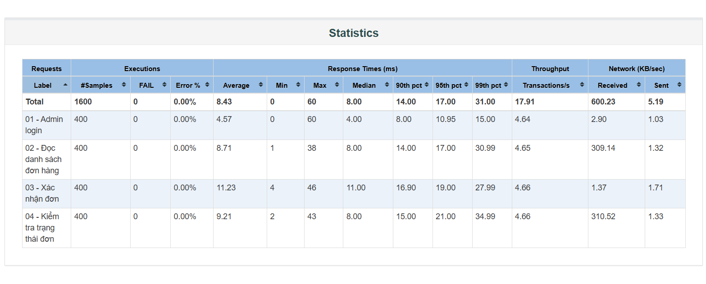

### 7.4 Spike (2 VU nền, đột biến lên 20 VU)

| Request | Samples | Lỗi | Avg | Median | P90 | P95 | P99 | Min | Max |
|---|---|---|---|---|---|---|---|---|---|
| 01 – Admin login | 76 | 0 | 7.1 | 6 | 12.0 | 18.2 | 32.0 | 2 | 32 |
| 02 – Đọc danh sách đơn hàng | 76 | 0 | 14.6 | 12 | 26.3 | 36.6 | 46.0 | 3 | 46 |
| 03 – Xác nhận đơn | 76 | 0 | 88.4 | 12 | 21.5 | 1282.7 | 1653.0 | 6 | 1653 |
| 04 – Kiểm tra trạng thái đơn | 76 | 0 | 31.7 | 11 | 32.0 | 33.3 | 1326.0 | 5 | 1326 |
| **Tổng** | **304** | **0** | **35.5** | **11** | **23.5** | **32.8** | **1324.3** | **2** | **1653** |

Chia theo pha (tính lại từ `spike.jtl`):

| Pha | Khoảng thời gian | Samples | Trung bình | P95 | Max |
|---|---|---|---|---|---|
| Trước đột biến | 0–14 s | 36 | 12.7 | 33 | 41 |
| Trong đột biến | 14–32 s | 188 | 12.9 | 29 | 40 |
| Sau đột biến | 32–66 s | 80 | 98.7 | 1282 | 1653 |

Cửa sổ đột biến (giây 15–20): 118 request trong 5 giây, khoảng 23.6 req/s, trung bình 13.2 ms, tối đa 40 ms.

**Kết luận: lượt chạy không ghi nhận lỗi khi tăng lên 20 VU, nhưng có năm outlier xuất hiện về sau. Một lượt chạy chưa đủ xác định capacity hay nguyên nhân.**

- **Trong đột biến:** không lỗi, độ trễ không tăng (trung bình 12.9 ms so với 12.7 ms trước đó).
- **Bất thường:** có 5 mẫu chậm 1,281–1,653 ms (4 mẫu bước 03, 1 mẫu bước 04) xuất hiện ở giây 49.7–56.1, tức **khoảng 26–33 giây sau record cuối của nhóm 18 VU**. Cả 5 mẫu đều thuộc hai VU nền (`Spike_Nen_2_users`), không mẫu nào thuộc nhóm 18 VU. Ở cả năm dòng JTL, `Latency` bằng `elapsed` và `Connect=0`: thời gian chậm được ghi nhận trước khi nhận byte phản hồi đầu tiên, không phải thời gian thiết lập kết nối. Điều này gợi ý có yếu tố chung xảy ra sau khi kết nối được thiết lập, nhưng JTL không xác định được đó là Node.js, database, lịch chạy của hệ điều hành hay thành phần khác.
- **Nguyên nhân:** chưa xác định. Log phía JMeter không đủ để kết luận. Cần log phía backend hoặc theo dõi tài nguyên theo thời gian. Lần chạy này cũng chưa được lặp lại nên chưa biết hiện tượng có tái hiện không.

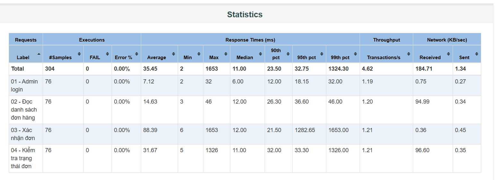

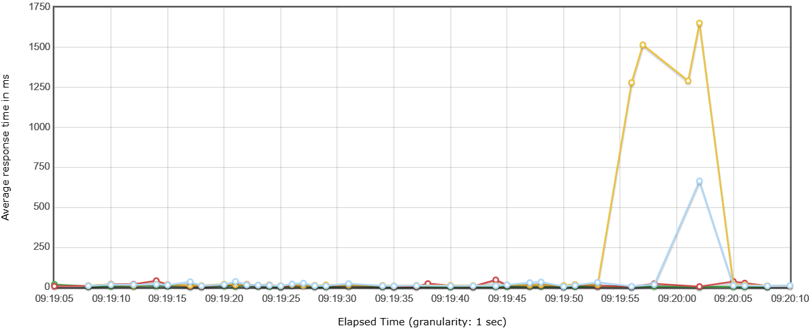

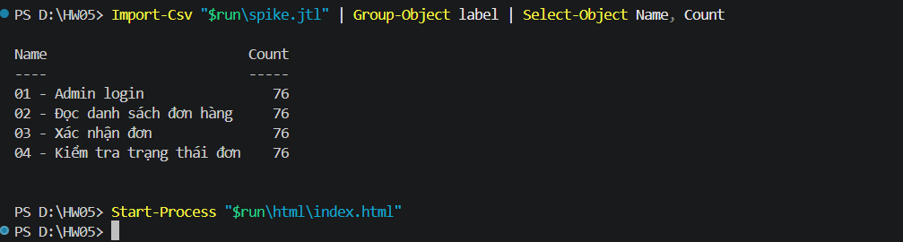

### 7.5 Soak (5 VU, 610 giây)

| Request | Samples | Lỗi | Avg | Median | P90 | P95 | P99 | Min | Max |
|---|---|---|---|---|---|---|---|---|---|
| 01 – Admin login | 975 | 0 | 5.4 | 3 | 10.0 | 20.2 | 44.0 | 0 | 67 |
| 02 – Đọc danh sách đơn hàng | 975 | 0 | 29.9 | 27 | 53.0 | 63.0 | 96.2 | 5 | 253 |
| 03 – Xác nhận đơn | 970 | 0 | 18.0 | 12 | 31.0 | 50.0 | 122.9 | 4 | 391 |
| 04 – Kiểm tra trạng thái đơn | 970 | 0 | 32.4 | 30 | 58.0 | 66.0 | 89.3 | 6 | 179 |
| **Tổng** | **3,890** | **0** | **21.4** | **15** | **47.0** | **59.0** | **93.1** | **0** | **391** |

Diễn biến theo phút (tính lại từ `soak.jtl`):

| Phút | Samples | Trung bình (ms) | P95 (ms) | Max (ms) | Request throughput (req/s) |
|---|---|---|---|---|---|
| 1 | 366 | 18.3 | 46.0 | 74 | 6.1 |
| 2 | 368 | 23.6 | 59.0 | 118 | 6.1 |
| 3 | 376 | 23.3 | 54.0 | 87 | 6.3 |
| 4 | 384 | 17.6 | 52.7 | 77 | 6.4 |
| 5 | 380 | 18.5 | 44.1 | 71 | 6.3 |
| 6 | 380 | 21.1 | 57.1 | 95 | 6.3 |
| 7 | 384 | 25.6 | 66.8 | 94 | 6.4 |
| 8 | 397 | 34.5 | 97.2 | 253 | 6.6 |
| 9 | 387 | 21.8 | 60.4 | 391 | 6.4 |
| 10 | 396 | 11.3 | 27.0 | 53 | 6.6 |

Còn 72 mẫu của 10 giây cuối (trung bình 12.9 ms, P95 28.9 ms, tối đa 44 ms), cộng đủ 3890 mẫu. Các số theo phút và theo nửa thời lượng được tính lại từ `soak.jtl`, nên P95 có thể lệch nhẹ so với dashboard JMeter do cách nội suy phân vị khác nhau.

**Kết luận: trong 10 phút quan sát, không thấy xu hướng suy giảm response time kéo dài.**

- Nửa đầu: trung bình 20.0 ms, P95 53 ms. Nửa sau: trung bình 22.8 ms, P95 64 ms. Chênh lệch nhỏ và không đơn điệu.
- Phút 8–9 có một đợt tăng (trung bình 34.5 ms, P95 97 ms, mẫu chậm nhất 391 ms) rồi tự trở về thấp (phút 10: 11.3 ms). Đây là dao động, không phải suy giảm tích lũy.
- Request throughput đi ngang 6.1–6.6 req/s. Tính theo 970 workflow hoàn tất trong 609.651 s, Soak đạt 1.5911 workflow/s; 5 workflow chưa hoàn tất khi lượt chạy dừng.

Đây là chỗ cần chú ý khi so sánh giữa các lần chạy: bước 02 và 04 ở Soak chậm hơn và payload cũng lớn hơn nhiều so với Load. Kích thước phản hồi là một yếu tố có thể góp phần, nhưng các lượt chạy không được kiểm soát để tách riêng tác động của payload khỏi khác biệt về dữ liệu và thời điểm chạy:

| Lần chạy | JMeter `bytes` trung bình cho một `GET /api/admin/orders` (KB, xấp xỉ) | Số đơn trong bảng (ước theo dải orderId) | Byte/đơn | Trung bình bước 02 |
|---|---|---|---|---|
| Load | 8.7 KB | ~54 | ~161 | 5.4 ms |
| Stress | 68.1 KB | ~400 | ~170 | 8.7 ms |
| Spike | 81.4 KB | ~476 | ~171 | 14.6 ms |
| Soak | 352.3 KB | ~2076 | ~170 | 29.9 ms |

Kích thước response body được JMeter ghi nhận tăng gần tuyến tính theo số đơn (khoảng 170 byte mỗi đơn); API không có phân trang. Với Soak, tốc độ request và payload này tương ứng khoảng 1.1 MB/s response-body bytes cho hai request đọc mỗi workflow hoàn tất. Đây không phải phép đo byte trên wire.

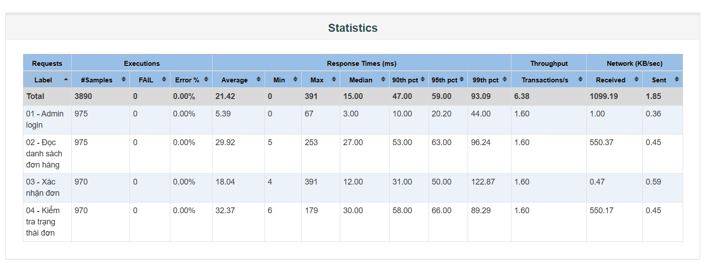

---

## 8. Tài nguyên máy và ngưỡng endurance

### 8.1 Bằng chứng tài nguyên (Task Manager, tiến trình backend)

Cột Memory trong Task Manager là *active private working set*, đơn vị K (1 K = 1024 byte).

| Lần chạy | Tiến trình | Thời điểm chụp | CPU | Memory | Ảnh |
|---|---|---|---|---|---|
| Load | `node.exe` PID 7492 | Ngay sau khi chạy xong | 00 | 12,412 K | `AfterLoad.png` |
| Stress | `node.exe` PID 11180 | Khoảng 10 s đầu (đang ramp-up) | 01 | 13,776 K | `stresswhilerun.png` |
| Spike | `node.exe` PID 11180 | Cuối lần chạy | 00 | 28,228 K | `spike.png` |
| Soak, phút 1 | `node.exe` PID 11180 | 00:01:00 | 01 | 26,136 K | `soak1.png` |
| Soak, phút 5 | `node.exe` PID 11180 | 00:04:59 | 00 | 42,320 K | `soak5.png` |
| Soak, phút 10 | `node.exe` PID 11180 | 00:10:10 (kết thúc) | 00 | 62,348 K | `soak9.png` |

Ở mọi lần chụp, JMeter và Task Manager nằm **trong cùng một khung hình**.

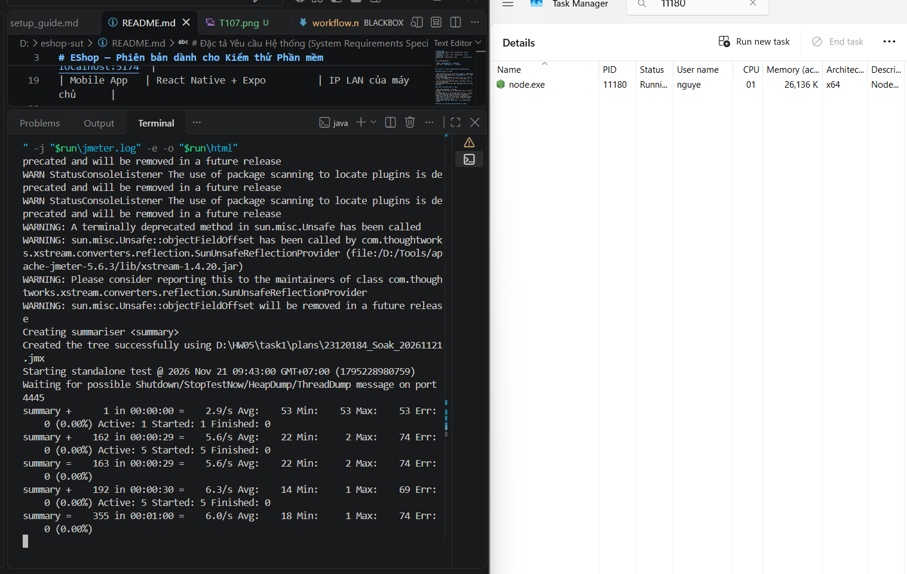

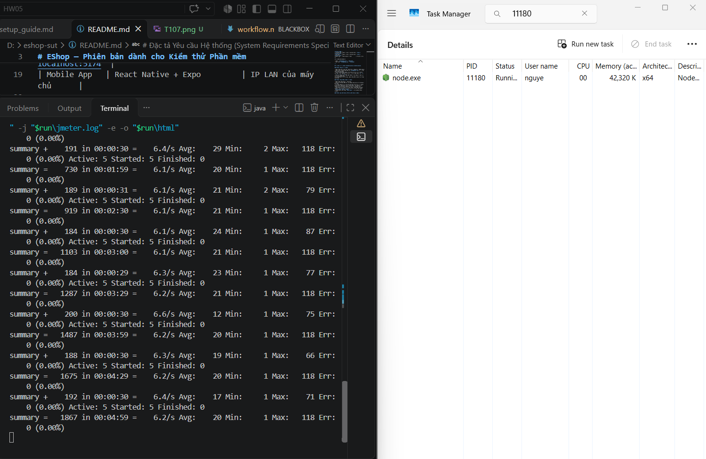

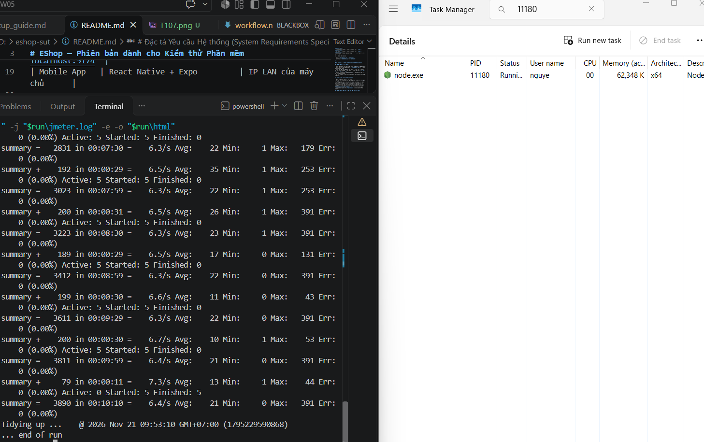

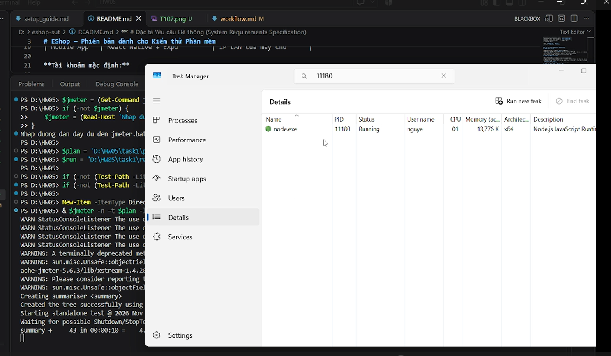

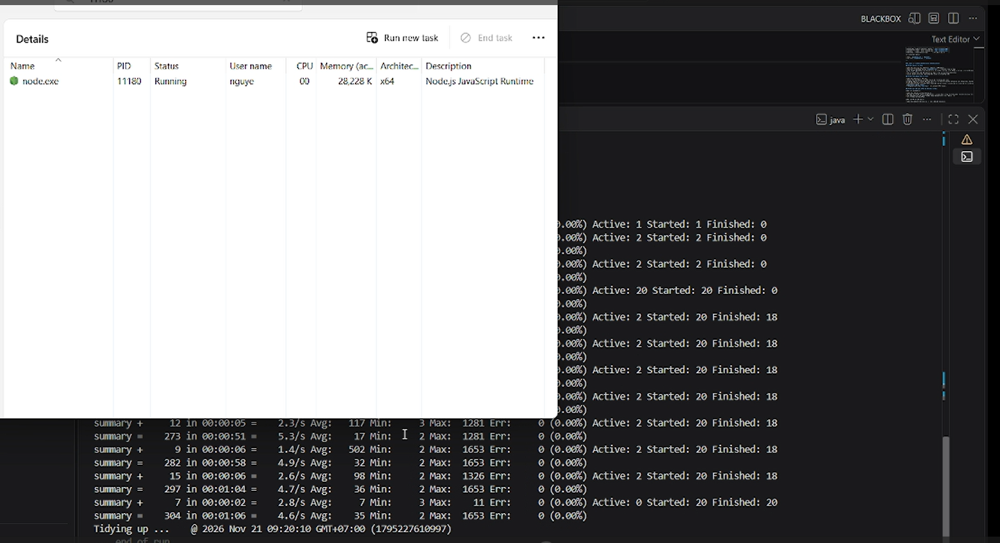

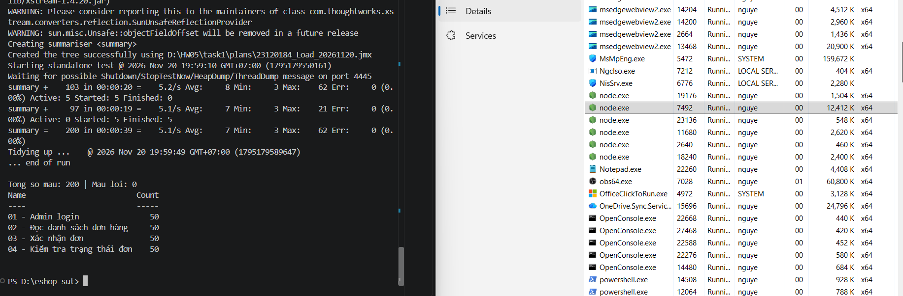

### 8.2 Ngưỡng endurance (từ Soak 10 phút)

| Chỉ số | Giá trị | Ghi chú |
|---|---|---|
| Thời lượng | 609.7 s (10 phút 10 s) | |
| Tải | 5 VU, 4 request/vòng, think-time 2–4 s | |
| **Request throughput trong Soak** | **6.38 req/s** (6.1–6.6 theo từng phút) | 0 lỗi trên 3,890 request; 970 workflow hoàn tất (1.5911 workflow/s) |
| Thời gian đáp ứng khi bền vững | Trung bình 21.4 ms, P95 59 ms, P99 93 ms, Max 391 ms | |
| **RPS đỉnh quan sát ngắn hạn** | **26.8 req/s** | Từ Stress, 20 VU, cửa sổ 10 s, P95 11.6 ms. Chỉ duy trì khoảng 30 s, **không phải** bền vững 10 phút. |
| **Memory backend (working set)** | 26,136 K (phút 1) → 42,320 K (phút 5) → **62,348 K (phút 10)** | Chênh lệch đầu–cuối là 36,212 K (khoảng 35.4 MiB), tương đương mức tăng ròng trung bình khoảng 3.9 MiB/phút giữa hai mốc đầu–cuối. Chỉ có ba snapshot nên không thể kết luận mức tăng liên tục hay tuyến tính. |
| **Memory cao nhất trong các snapshot** | **62,348 K (khoảng 60.9 MiB)** | Không ghi nhận plateau trong các thời điểm chụp; dữ liệu không xác định memory limit hay memory leak. |
| CPU backend | 00–01% ở mọi lần chụp | Ảnh chụp tại một thời điểm, không phải số đo liên tục. |

Cách đọc các con số:

- **Think-time giới hạn tốc độ phát request của workload đóng vòng.** Mỗi VU thực hiện bốn request và một think-time trung bình khoảng 3 s mỗi vòng; ước tính thô là `4 × VU / (3 s + thời gian xử lý)`. Mức này tương ứng khoảng 6.5 req/s ở 5 VU và 26 req/s ở 20 VU, gần với số đo. Điều đó giải thích offered rate của kịch bản, nhưng không chứng minh server đã đạt hay chưa đạt capacity. Trong các mức tải đã thử, chưa thấy lỗi hoặc suy giảm rõ; capacity tối đa vẫn chưa được đo.
- **Các snapshot cho thấy working set cao hơn theo từng thời điểm, nhưng không đủ kết luận rò rỉ.** Chỉ có ba điểm chụp, không có chuỗi đo sau khi dừng tải; V8 cũng có thể giữ bộ nhớ trước khi garbage collection. Cần theo dõi RSS/heap liên tục và sau khi tải dừng để phân biệt memory leak với bộ nhớ chưa được thu hồi.

---

## 9. Video demo

**Link video demo (toàn bộ): [Xem video demo](https://www.youtube.com/watch?v=J2pilpxvBZo)**


---

## 10. Lỗi và vấn đề hiệu năng

**Lỗi chức năng: 0.** Không có lỗi HTTP, assertion hay crash trong 5,994 request.

Ba issue theo dõi các phát hiện hiệu năng đã được tạo trên repo [nguyenanhtuan2702/eshop-sut](https://github.com/nguyenanhtuan2702/eshop-sut). Chúng là các vấn đề cần điều tra hoặc tối ưu, không phải kết luận đã xác định nguyên nhân.

| # | Vấn đề | Bằng chứng | Link issue |
|---|---|---|---|
| 1 | `GET /api/admin/orders` trả toàn bộ bảng đơn, không phân trang. Response body được JMeter ghi nhận tăng cùng quy mô dữ liệu (~170 byte/đơn); chưa tách riêng tác động của payload đến latency. | Mục 7.5; cột `bytes` trong các file `.jtl` | [nguyenanhtuan2702/eshop-sut#201](https://github.com/nguyenanhtuan2702/eshop-sut/issues/201) |
| 2 | Có 5 mẫu chậm 1.28–1.65 s ở `PUT .../status` và `GET /api/admin/orders` sau cửa sổ high-concurrency. `Connect=0`; JTL không xác định nguyên nhân. | `spike.jtl` (giây 49.7–56.1); ảnh `flotResponseTimesOverTime.png` | [nguyenanhtuan2702/eshop-sut#202](https://github.com/nguyenanhtuan2702/eshop-sut/issues/202) |
| 3 | Working set tăng qua ba snapshot: 26,136 K → 42,320 K → 62,348 K trong khoảng Soak. Đây không phải bằng chứng về memory leak. | `soak1.png`, `soak5.png`, `soak9.png` | [nguyenanhtuan2702/eshop-sut#203](https://github.com/nguyenanhtuan2702/eshop-sut/issues/203) |

**Số issue đã tạo: 3.** Các ảnh/JTL minh chứng vẫn được ghi bằng tên file trong issue vì chúng chưa có trên repo `eshop-sut`; không có tệp nào được đẩy lên repo này.

---

## 11. Hạn chế

1. **Stress chưa tìm được điểm gãy.** 20 VU với think-time 2–4 s tạo khoảng 26 request/s trong workload đã thử; chưa thấy lỗi hoặc suy giảm rõ, nhưng đây không phải bằng chứng về server capacity. Muốn tìm ngưỡng suy giảm cần tăng VU (ví dụ 50, 100, 200) hoặc giảm think-time theo kế hoạch, đồng thời giữ payload và dữ liệu nhất quán.
2. **Ảnh tài nguyên chụp tại một thời điểm.** Ảnh Stress chụp lúc 10 giây đầu (đang ramp-up, chưa phải giai đoạn 20 VU), nên CPU 01% chưa đại diện cho lúc tải cao nhất. Số đo tài nguyên liên tục theo thời gian chưa có.
3. **Không so sánh trực tiếp giữa các lần chạy** vì bảng đơn hàng lớn dần (mục 7.5).
4. **Khóa tài khoản chưa được kiểm thử dưới tải.** Chỉ dùng tài khoản hợp lệ nên cơ chế khóa sau 3 lần sai không bị kích hoạt.
5. **Assertion chỉ chặt ở hai bước đọc.** Bước đăng nhập và bước PUT chỉ kiểm tra mã HTTP. Trạng thái nghiệp vụ được xác nhận gián tiếp ở bước 04.
6. **Bất thường của Spike** chỉ xuất hiện một lần, chưa được lặp lại và chưa rõ nguyên nhân.
7. **Soak 10 phút và ba snapshot bộ nhớ** chưa đủ để đánh giá plateau, giới hạn bộ nhớ hay memory leak.
8. JMeter và backend chạy chung một máy nên cạnh tranh tài nguyên; số đo mang tính tham khảo cho phần cứng này.

---

## 12. Đối chiếu yêu cầu Task 1

| Yêu cầu | Trạng thái | Vị trí |
|---|---|---|
| Ba test plan Load/Stress/Spike, cùng một luồng, phủ 3 nhóm endpoint | Có | Mục 3, 5; thư mục `plans/` |
| Tên plan theo `{StudentID}_{ScenarioType}_{YYYYMMDD}` | Có | `plans/23120184_*.jmx` |
| Dữ liệu điều khiển bằng CSV | Có | Mục 4; thư mục `data/` |
| Ba report view khác nhau | Có | Mục 5.3 |
| Prompt từng bước, rà soát và sửa lỗi của AI | Có tài liệu phân tích, human review và AI critique | [`AI_Analysis.md`](../task2/AI_Analysis.md), [`Misinterpretation_Hunt.md`](../task2/Misinterpretation_Hunt.md), [`Human_Review.md`](../task2/Human_Review.md), [`AI_Critique.md`](../ai/AI_Critique.md) |
| Chạy đủ 3 kịch bản, log `.jtl` thô và thư mục HTML | Có | Mục 6; thư mục `results/` |
| Ảnh công cụ cùng tài nguyên backend cho từng lần chạy | Có | Mục 8.1; `evidence/` |
| Báo cáo phần cứng (dxdiag/screenfetch) và bảng cấu hình | Có bảng cấu hình và ảnh PowerShell; **không phải ảnh dxdiag/screenfetch** | Mục 2; [ảnh 1](evidence/eviroment1.png), [ảnh 2](evidence/eviroment2.png) |
| Ghi cách reset khóa tài khoản giữa các lần chạy | Không áp dụng (0 lần đăng nhập thất bại) | Mục 4 |
| Endurance 10–15 phút với số liệu cụ thể | Có | Mục 8.2 |
| Video demo YouTube unlisted ≥ 6 phút | Có | Mục 9 |
| Ghi lỗi/vấn đề hiệu năng lên GitHub Issues | Đã tạo 3 issue; link đã đối chiếu đúng repo | [#201](https://github.com/nguyenanhtuan2702/eshop-sut/issues/201), [#202](https://github.com/nguyenanhtuan2702/eshop-sut/issues/202), [#203](https://github.com/nguyenanhtuan2702/eshop-sut/issues/203) |
