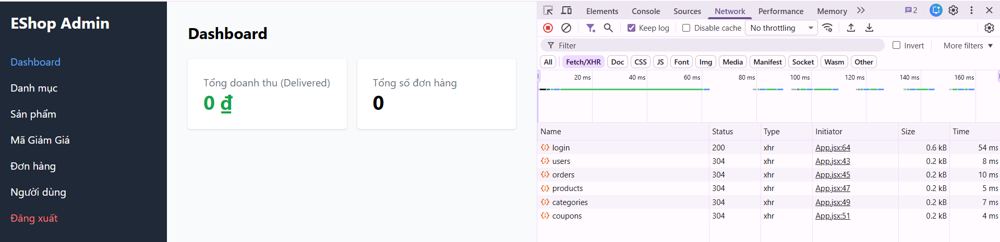
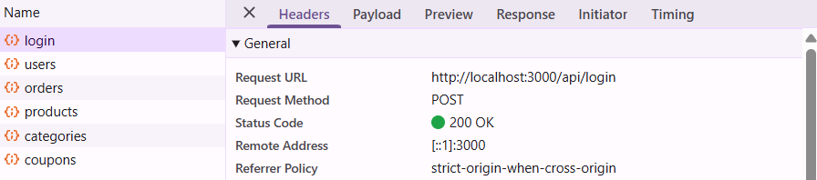
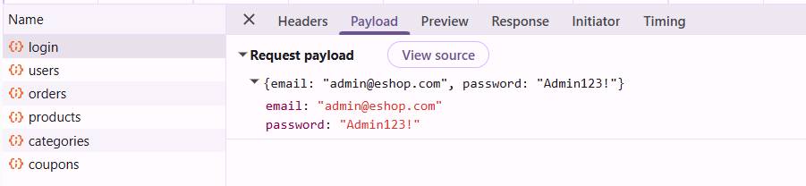

# HW05 · Luồng quản trị viên xác nhận đơn hàng

Trong cả ba kịch bản Load, Stress và Spike, mỗi người dùng ảo đăng nhập bằng tài khoản quản trị, đọc danh sách đơn, xác nhận một đơn đang ở trạng thái `pending`, rồi đọc lại để kiểm tra chính đơn đó đã chuyển sang `confirmed`. Các ảnh dưới đây ghi nhận lần khảo sát thủ công trên EShop bằng Chrome DevTools ngày 20/11/2026.

## 1. Đăng nhập quản trị viên (auth-heavy)

Sau khi đăng nhập, EShop mở Dashboard. Trong tab Network, request `login` trả HTTP 200. Dashboard tiếp tục tải các tài nguyên, trong đó có `orders`.

Phần Headers xác nhận trình duyệt gửi `POST /api/login` đến `http://localhost:3000` và backend trả `200 OK`.

Payload chứa hai trường `email` và `password`. Đây là hai trường đầu vào của bước đăng nhập trong JMeter.

## 2. Đọc đơn đang chờ xác nhận (read-heavy)

Trong phản hồi của request có tên `orders`, bản ghi hiển thị `status = pending`, `total_amount = 28000000` và `created_at = 2026-11-20 08:30:32`. Giá trị `pending` là điều kiện đầu vào cho thao tác xác nhận.

## 3. Xác nhận đơn và kiểm tra trạng thái (transactional)

Sau thao tác xác nhận trên giao diện, phản hồi hiển thị `status = confirmed`. Tổng tiền và thời điểm tạo trùng với bản ghi ở T104. Trong JMeter, tiêu chí đạt là phản hồi đọc lại chứa một phần tử đồng thời thỏa mãn `id = orderId` lấy từ CSV và `status = confirmed`. Điều kiện này tránh nhầm với một đơn khác đã được xác nhận từ trước.

## 4. Thông tin cần bổ sung khi dựng JMeter

- Ghi method và URL đầy đủ của request đọc danh sách đơn. Kiểm tra cách trình duyệt gửi thông tin xác thực sau đăng nhập.
- Ghi Headers và Payload của request cập nhật để xác định method, URL, vị trí mã đơn và tên trường trạng thái.
- Khi tải lại danh sách, ghi mã đơn trước và sau thao tác. Phần hiển thị của T104 và T105 chỉ có `user_id`, là mã người dùng. Mã đơn `id` nằm ngoài vùng ảnh.

## 5. Dữ liệu và kế hoạch đo

Mỗi vòng lấy một orderId riêng trong data/orders.csv. Chuẩn bị đơn pending trước khi đo. Dùng lại bộ dữ liệu sau khi đã phục hồi trạng thái ban đầu. Nếu login thất bại, dừng lượt đó. Nếu bị khóa sau 3 lần sai, ghi cách reset giữa các lần chạy.

| Kịch bản | Thread / ramp-up / thời lượng / think-time | Lý do chọn | Report view |
|---|---|---|---|
| Load | | | |
| Stress | | | |
| Spike | | | |
| Soak | Duy trì 10–15 phút | Xác minh mức tải ổn định | |

Lưu JMX ở plans/. Với mỗi lần chạy, lưu raw JTL và thư mục HTML trong results/<kịch bản>/. Ghi lại đề xuất ban đầu của AI, điểm tự sửa và lý do trước khi đo.
