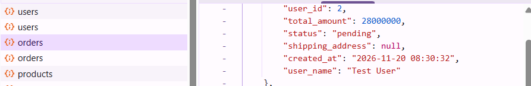
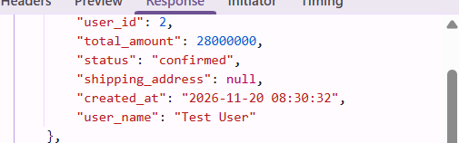
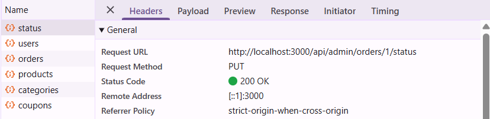
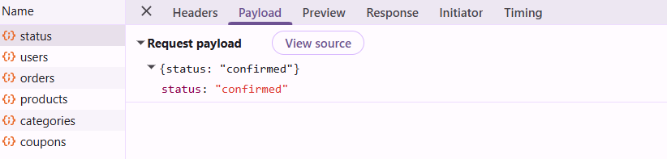
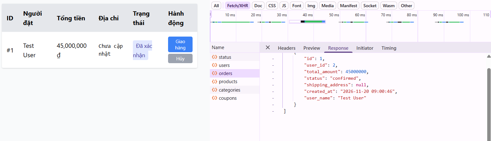

# HW05 · Luồng quản trị viên xác nhận đơn hàng

Trong cả bốn kịch bản Load, Stress, Spike và Soak, mỗi người dùng ảo đăng nhập bằng tài khoản quản trị, đọc danh sách đơn, xác nhận một đơn đang ở trạng thái `pending`, rồi đọc lại để kiểm tra chính đơn đó đã chuyển sang `confirmed`. Các ảnh dưới đây ghi nhận lần khảo sát thủ công trên EShop bằng Chrome DevTools ngày 20/11/2026.

## 1. Đăng nhập quản trị viên (auth-heavy)

Sau khi đăng nhập, EShop mở Dashboard. Trong tab Network, request `login` trả HTTP 200. Dashboard tiếp tục tải các tài nguyên, trong đó có `orders`.

Phần Headers xác nhận trình duyệt gửi `POST /api/login` đến `http://localhost:3000` và backend trả `200 OK`.

Payload chứa hai trường `email` và `password`. Đây là hai trường đầu vào của bước đăng nhập trong JMeter.

## 2. Đọc đơn đang chờ xác nhận (read-heavy)

Trong phản hồi của request có tên `orders`, bản ghi hiển thị `status = pending`, `total_amount = 28000000` và `created_at = 2026-11-20 08:30:32`. Giá trị `pending` là điều kiện đầu vào cho thao tác xác nhận.

## 3. Xác nhận đơn và kiểm tra trạng thái (transactional)

Sau thao tác xác nhận trên giao diện, phản hồi hiển thị `status = confirmed`. Tổng tiền và thời điểm tạo trùng với bản ghi ở T104. Trong JMeter, tiêu chí đạt là phản hồi đọc lại chứa một phần tử đồng thời thỏa mãn `id = orderId` lấy từ CSV và `status = confirmed`. Điều kiện này tránh nhầm với một đơn khác đã được xác nhận từ trước.

### Kiểm tra trên đơn #1

Ở lượt kiểm tra tiếp theo, dữ liệu ban đầu của đơn #1 có `status = pending` và `total_amount = 45000000`. Khi quản trị viên xác nhận đơn, trình duyệt gửi `PUT /api/admin/orders/1/status` tới `http://localhost:3000`. Backend trả `200 OK`.

Mã đơn nằm trong URL. Phần body chứa trạng thái đích `{"status":"confirmed"}`.

Trong phản hồi đọc lại từ `orders`, bản ghi có `id = 1` mang trạng thái `confirmed`. Giao diện cũng hiển thị “Đã xác nhận” cho đơn #1.

## 4. Ánh xạ sang JMeter

| Thành phần | Cấu hình hoặc điều kiện kiểm tra |
|---|---|
| HTTP Request cập nhật | Method `PUT`, path `/api/admin/orders/${orderId}/status` |
| Body Data | `{"status":"confirmed"}` |
| Điều kiện trước khi cập nhật | Tìm đúng `orderId` từ CSV trong danh sách và kiểm tra trạng thái `pending` |
| Điều kiện đạt | Request cập nhật trả HTTP 200 và lần đọc sau trả đúng `orderId` với trạng thái `confirmed` |

Request `orders` dùng method `GET` tới `/api/admin/orders` và gửi kèm header `Authorization: Bearer <token>`. Token lấy từ phản hồi của request `login`; trong JMeter, JSON Extractor `$.token` lưu vào biến `adminToken` rồi gắn vào header của các bước 02, 03 và 04. Lần chạy thử dùng đơn #1 đang ở trạng thái `pending` (ảnh T106 đến T108).

## 5. Dữ liệu và kế hoạch đo

Mỗi vòng lấy một `orderId` riêng trong file CSV của kịch bản: `data/orders.csv` (Load), `data/orders_stress.csv`, `data/orders_spike.csv` và `data/orders_soak.csv`. Đơn `pending` được chuẩn bị trước khi đo và chỉ dùng lại bộ dữ liệu sau khi đã phục hồi trạng thái ban đầu. Nếu login thất bại, thread dừng (`on_sample_error = stopthread`) để không gửi tiếp các lần đăng nhập sai. Trong cả bốn lần chạy không có lần login nào thất bại, nên không bị khóa sau 3 lần sai và không phải reset khóa.

Think-time dùng chung cho cả bốn kịch bản: Uniform Random Timer 2000 ms cộng ngẫu nhiên 0–2000 ms (2–4 s), gắn vào bước xác nhận đơn.

| Kịch bản | Thread / ramp-up / thời lượng / think-time | Lý do chọn | Report view |
|---|---|---|---|
| Load | 5 thread / 10 s / 10 vòng mỗi thread (50 vòng, khoảng 39 s) / 2–4 s | Mô phỏng vài quản trị viên xử lý đơn cùng lúc, làm mốc so sánh cho các kịch bản còn lại. | Summary Report |
| Stress | 20 thread / 30 s / 20 vòng mỗi thread (400 vòng, khoảng 89 s) / 2–4 s | Gấp 4 lần Load, ramp-up dài hơn để tải tăng dần và quan sát ngưỡng bắt đầu suy giảm. | Aggregate Report |
| Spike | 2 thread nền (20 vòng) và 18 thread đột biến (delay 15 s, 2 vòng) / ramp-up 1 s cho cả hai nhóm / khoảng 66 s / 2–4 s | Tải nền thấp, sau 15 s thêm 18 thread trong 1 s (tổng 20, gấp 10 lần nền), rồi trở lại tải nền để quan sát khả năng phục hồi. | Aggregate Graph |
| Soak | 5 thread / 10 s / 610 s (10 phút 10 s), lặp vô hạn / 2–4 s | Duy trì 10–15 phút. Xác minh mức tải ổn định bằng mức tải của Load và theo dõi xu hướng bộ nhớ. | Summary Report |

Số dòng CSV khớp số vòng lặp: Load 50, Stress 400, Spike 76 (2 × 20 + 18 × 2), Soak 1600 (dư so với 970 vòng thực tế).

File JMX lưu ở `plans/` theo tên `23120184_<Kịch bản>_<YYYYMMDD>.jmx`. Với mỗi lần chạy, raw JTL, `jmeter.log` và thư mục HTML được lưu trong `results/<kịch bản>/<thời điểm chạy>/`.

| Kịch bản | Thư mục kết quả |
|---|---|
| Load | `results/load/20261120_195907/` |
| Stress | `results/stress/20261121_084816/` |
| Spike | `results/spike/20261121_091902/` |
| Soak | `results/soak/20261121_094256/` |

Đề xuất ban đầu của AI, điểm tự sửa và lý do được trình bày ở báo cáo AI riêng.

## 6. GitHub Issues theo dõi các phát hiện

Các issue dưới đây ghi nhận quan sát và hướng điều tra; chúng không khẳng định nguyên nhân gốc đã được xác định.

| Issue | Nội dung |
|---|---|
| [nguyenanhtuan2702/eshop-sut#201](https://github.com/nguyenanhtuan2702/eshop-sut/issues/201) | Danh sách đơn quản trị được trả toàn bộ khi workflow cần kiểm tra một đơn. |
| [nguyenanhtuan2702/eshop-sut#202](https://github.com/nguyenanhtuan2702/eshop-sut/issues/202) | Năm request Spike có response time trên một giây sau cửa sổ high-concurrency quan sát được. |
| [nguyenanhtuan2702/eshop-sut#203](https://github.com/nguyenanhtuan2702/eshop-sut/issues/203) | Working set của Node.js tăng qua ba snapshot trong Soak; chưa đủ bằng chứng kết luận memory leak. |

Các tên ảnh và JTL trong issue #201–#203 được giữ nguyên vì các tệp minh chứng chưa có trên repo `eshop-sut`; không có code hay tệp minh chứng nào được push lên repo đó.
