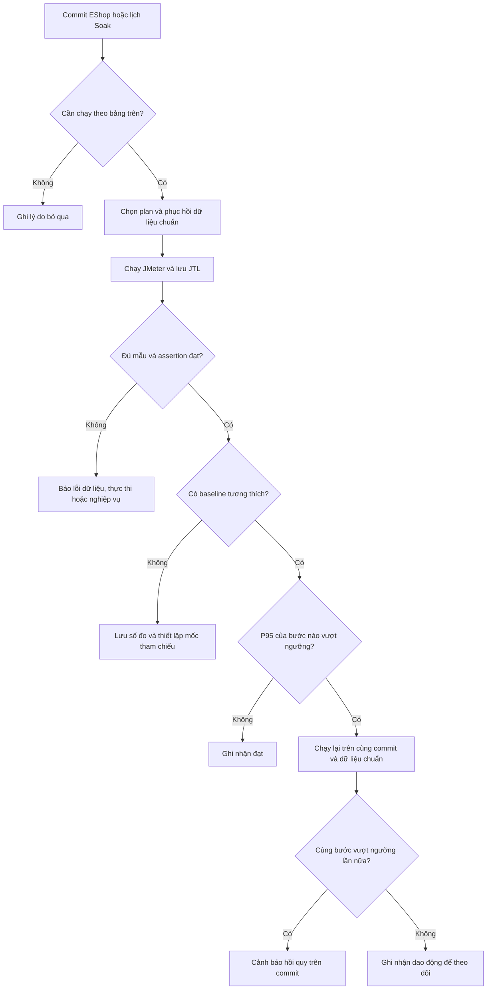

# Task 3 — Đề xuất kiểm thử hiệu năng liên tục cho EShop

**MSSV 23120184 · Kết luận của báo cáo HW05**

Trong Task 1, cả 304 request của kịch bản Spike đều thành công. Tuy nhiên, ở riêng bước xác nhận đơn, 4 trong 76 request mất hơn một giây. Một thay đổi khiến quản trị viên phải chờ lâu hơn vẫn có thể vượt qua toàn bộ kiểm tra trạng thái đơn. Vì vậy, mô hình đề xuất theo dõi commit của EShop và so sánh P95 của từng bước với phiên bản đã được chấp nhận. Các lượt đo ở Task 1 cung cấp ví dụ thực tế cho thiết kế này. Quy trình CI dưới đây là đề xuất triển khai.

## 1. Khi nào chạy JMeter?

Khi có commit mới trên nhánh đang xét, hệ thống CI lấy mã commit (SHA) và danh sách tệp thay đổi của **repo mã nguồn EShop**. Bộ kiểm thử dùng các plan JMeter từ repo HW05. Mỗi kết quả ghi lại cả SHA của EShop và phiên bản plan để xác định chính xác mã nguồn và bài đo.

| Thay đổi hoặc sự kiện | Quyết định đề xuất | Lý do |
|---|---|---|
| Chỉ sửa README, ảnh minh họa hoặc tài liệu | Bỏ qua JMeter, ghi lý do vào kết quả kiểm tra của commit | Những tệp này không tham gia xử lý request. |
| Sửa API đăng nhập, đọc đơn, xác nhận đơn, mã dùng chung hoặc dependency backend | Chạy Load cho cả bốn bước | Thay đổi một bước có thể làm chậm bước tiếp theo. Luồng ngắn đã có assertion kiểm tra đúng đơn trước và sau khi ghi. |
| Sửa truy vấn, schema hoặc xử lý đồng thời khi cập nhật đơn | Chạy thêm Stress và Spike | Load với 5 người dùng có thể bỏ sót thời gian chờ chỉ xuất hiện khi nhiều quản trị viên cùng thao tác. |
| Thay đổi chưa phân loại được | Chạy Load | Giảm khả năng bỏ qua hồi quy do một tệp mới chưa nằm trong bộ lọc. |
| Lịch đêm có commit backend mới kể từ lần Soak gần nhất | Chạy Soak trên phiên bản mới nhất | Theo dõi ảnh hưởng của tải kéo dài mà vẫn giữ thời gian phản hồi ngắn cho từng commit. |

## 2. Lưu đồ quyết định

## 3. So sánh P95 và nội dung cảnh báo

Đề xuất lấy trung vị P95 của **ba lượt chạy hợp lệ trên phiên bản tham chiếu đã duyệt** làm baseline cho từng cặp *kịch bản × bước*. Cả ba lượt và commit mới dùng cùng phiên bản JMeter, cấu hình máy, think-time, cách tính phân vị và cùng ảnh chụp cơ sở dữ liệu ban đầu. Trước mỗi lượt, phục hồi ảnh chụp có sẵn các đơn `pending` và CSV tương ứng. Việc này vừa giữ kích thước danh sách đơn tương đương, vừa tránh dùng lại đơn đã chuyển thành `confirmed`. P95 lấy thống nhất từ trường `pct2ResTime` trong dashboard JMeter theo từng nhãn request.

Gọi B là P95 tham chiếu và C là P95 của commit mới. **Ngưỡng thử nghiệm đề xuất** là C lớn hơn 1,20 × B **và** C − B ít nhất 5 ms. Điều kiện tuyệt đối tránh phát cảnh báo chỉ vì một bước rất nhanh tăng từ 4 lên 5 ms. Khi một bước vượt cả hai điều kiện, chạy lại cùng commit với dữ liệu đã phục hồi. Nếu lượt chạy lại hợp lệ và cùng bước vẫn vượt ngưỡng, CI gắn cảnh báo lên commit. Lượt chạy lỗi assertion hoặc thiếu mẫu được báo riêng và loại khỏi phép so sánh. Chỉ cập nhật baseline sau khi phiên bản tham chiếu mới đã được duyệt.

**Ví dụ minh họa.** Dashboard Load ở Task 1 ghi P95 của bước 03 là **20,45 ms**. Giả sử ba lượt tham chiếu cho trung vị đúng bằng giá trị đó. Nếu commit mới đạt 27 ms thì mức tăng là 6,55 ms, tương đương 32,0%, đủ để chạy xác nhận. Nếu lần hai cho 26 ms thì bước 03 vẫn vượt cả hai điều kiện. Cảnh báo đính kèm SHA, tên plan, nhãn `03 - Xác nhận đơn`, số mẫu, P95 tham chiếu, hai P95 mới và liên kết JTL/dashboard. Hai giá trị 27 và 26 ms là số giả định để minh họa quyết định.

## 4. Chi phí và nguy cơ báo động giả

**Chi phí chạy.** Khoảng đo thực tế ở Task 1 lần lượt xấp xỉ 39 giây cho Load, 89 giây cho Stress, 66 giây cho Spike và 610 giây cho Soak. Chạy đủ bốn plan nối tiếp tốn khoảng 13 phút 24 giây cho mỗi commit, chưa kể chuẩn bị dữ liệu và xuất báo cáo. Chọn Load cho thay đổi thông thường giúp phản hồi sớm. Đổi lại, một hồi quy chỉ xuất hiện sau nhiều phút có thể đến lượt Soak ban đêm mới lộ ra.

**Báo động giả và lỗi có thể bỏ sót.** Trong Task 2, cùng 76 mẫu xác nhận đơn của Spike cho P95 là 347,25 ms theo cách nội suy của bản phân tích và 1.282,65 ms theo dashboard. Đổi công thức giữa hai phiên bản có thể tạo cảnh báo ngay cả khi dữ liệu giống hệt nhau. Chuẩn hóa cách tính, số đơn và môi trường đo giúp giảm nhiễu. Chạy xác nhận lần hai tốn thêm thời gian và có thể bỏ sót lỗi chập chờn, nên hệ thống vẫn lưu JTL của lần đầu cùng số request vượt một giây để điều tra. Sau khi tích lũy đủ lịch sử, nhóm có thể điều chỉnh mức 20% và 5 ms theo độ dao động thực tế của từng bước.

Với luồng quản trị EShop, kết quả cần báo cho người sửa mã là **commit nào làm chậm bước nào, chậm bao nhiêu và hiện tượng có lặp lại hay không**. P95 theo từng bước, assertion theo mã đơn và log gắn với SHA cung cấp đủ thông tin để trả lời ba câu hỏi đó khi mô hình được triển khai.
